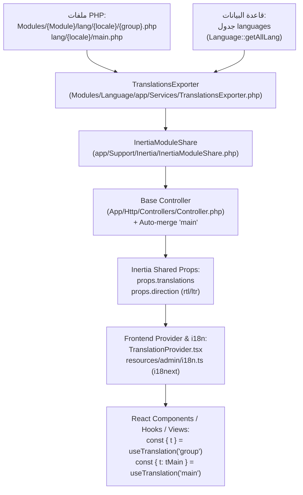

# مهارة إدارة وتقسيم ونقل الترجمات بين الباك إند والفرونت إند (i18n & Translation Workflow)

> **المرجع الإلزامي لتطوير وتنظيم ملفات الترجمة، سياسة منع النصوص الثابتة نهائياً، معمارية تمرير الترجمات من Laravel إلى Inertia، واستهلاكها في React عبر `react-i18next` (`useTranslation`, `tMain`).**

---

## 1. القاعدة الأساسية الصارمة: منع النصوص الثابتة نهائيًا (Zero Hardcoded Text Policy)

> [!CAUTION]
> **يُمنع منعًا باتًا كتابة أي نص ثابت (Hardcoded String) باللغة العربية أو الإنجليزية داخل كود الفرونت إند.**
> يشمل ذلك:
> - عناوين الصفحات والمسارات (`Head`, `breadcrumbs`, `h1-h6`).
> - أسماء الأزرار والروابط (`Button`, `Link`).
> - نصوص الحقول والتسميات (`Label`, `Input`, `Select`, `Textarea`).
> - النصوص التوضيحية (`placeholder`, `aria-label`, `title`).
> - رسائل التنبيه والـ Toasts (`toast.success`, `toast.error`, `toast.loading`, `toast.promise`).
> - نوافذ التأكيد والديالوجات (`confirmAlertDialog`, `AlertDialog`, `Dialog`, `Drawer`).
> - التلميحات (`TooltipContent`, `TooltipTrigger`).
> - عناوين الأعمدة في الجداول (`ColumnLabels`, `lables/*.tsx`).
> - رسائل التحقق وحالات البطاقات والفلاتر (`Active`, `Inactive`, `All`, `No results`).

### كيف يلتزم المطور والوكيل بهذه القاعدة:
1. **المصدر الوحيد للنصوص هو ملفات الترجمة**: أي نص يظهر للمستخدم في الواجهة يجب استدعاؤه حصريًا عبر `t(...)` أو `tMain(...)` أو دوال `i18n.ts`.
2. **تجهيز ملفات الترجمة العربية فورًا عند كتابة الكود**:
   - عند إنشاء أي شاشة أو ميزة أو زر أو رسالة جديدة، يتم إضافة المفتاح والنص العربي المقابل داخل ملف الـ PHP المناسب:
     - إذا كان النص عاماً ومشتركاً ⬅️ `lang/ar/main.php`.
     - إذا كان النص خاصاً بصفحة موديول ⬅️ `Modules/{ModuleName}/lang/ar/{group}.php` (مثال: `Modules/Shop/lang/ar/brand.php`).
3. **الهدف المعماري**: إتاحة دعم أي لغة إضافية مستقبلاً (الإنجليزية، الكردية، وغيرها) بمجرد إنشاء ملف ترجمة جديد للغة المستهدفة **دون تعديل سطر واحد في كود الفرونت إند (React / TSX)**.

---

## 2. معمارية تدفق الترجمات (Architecture & Data Lifecycle)



### شرح دورة الحياة:
1. **التخزين في الباك إند**:
   - الترجمات الأساسية موجودة في ملفات PHP كـ Key-Value arrays.
   - إذا كان موديول `Language` مفعلاً، يتم فحص جدول `languages` في قاعدة البيانات لدمج أي تعديلات حية على الترجمات (مع أولوية قاعدة البيانات).
2. **التصدير والمشاركة عبر Inertia**:
   - الـ Controller يرث من `App\Http\Controllers\Controller`.
   - يقوم الـ Base Controller بتشغيل `InertiaModuleShare::share()` لتحميل ترجمات الموديول المطلوبة عبر `$inertiaTranslationGroups` ومساحة الاسم `$inertiaTranslationNamespaces`.
   - يقوم الـ Base Controller **تلقائيًا** بدمج ترجمات المجموعة العامة `main` (`resolveMainTranslations()`) في `translations` حتى لا يحتاج كل Controller لإضافتها يدويًا.
3. **الاستقبال والتحديث في الفرونت إند**:
   - `TranslationProvider` يستمع لتغير `usePage().props.translations` ويستدعي `updateTranslations()` لدمج الموارد الجديدة في `i18next` دون إعادة تحميل الصفحة بالكامل.
   - اسم المجموعة `$group` في الباك إند يصبح هو اسم الـ Namespace في `i18next`.

---

## 3. قواعد تقسيم وتنظيم ملفات الترجمة (File Splitting & Organization)

### أ. قاعدة المسارات (Directory Structure)

1. **ملفات ترجمة الموديول**:
   `Modules/{ModuleName}/lang/{locale}/{group}.php`
   - مثال: `Modules/Shop/lang/ar/brand.php` (خاص بصفحة العلامات التجارية)
   - مثال: `Modules/Shop/lang/ar/product.php` (خاص بصفحة المنتجات)
   - مثال: `Modules/Shop/lang/ar/order.php` (خاص بصفحة الطلبات)

2. **ملفات الترجمة الرئيسية العامة**:
   `lang/{locale}/{group}.php`
   - `lang/ar/main.php` (النصوص العامة المشتركة لكل صفحات ولوحات النظام)
   - `lang/ar/profile.php` (صفحة الملف الشخصي)
   - `lang/ar/appearance.php` (صفحة المظهر)
   - `lang/ar/security.php` (صفحة الأمان)

### ب. قاعدة: ملف ترجمة مستقل لكل صفحة/مورد (1-to-1 Page-to-File Rule)

> [!IMPORTANT]
> **ممنوع دمج ترجمات أكثر من صفحة في ملف واحد.**
> - كل صفحة أو مورد يملك ملف ترجمة واحد مستقل باسم المورد بصيغة المفرد أو الجمع المتفق عليه (مثال: `brand.php`, `category.php`, `product.php`).
> - يطلب الـ Controller ملف الترجمة الخاص بصفحته فقط، مما يقلل حجم Payload المنقول عبر الشبكة إلى أقل قدر ممكن.

**جدول التوافق والربط بين المكونات:**

| الصفحة في الفرونت إند | ملف الترجمة في الباك إند | `$inertiaTranslationNamespaces` | `$inertiaTranslationGroups` | استدعاء الهوك في الفرونت إند |
| :--- | :--- | :--- | :--- | :--- |
| `brands.tsx` | `Modules/Shop/lang/ar/brand.php` | `'shop'` | `['brand']` | `useTranslation('brand')` |
| `products.tsx` | `Modules/Shop/lang/ar/product.php` | `'shop'` | `['product']` | `useTranslation('product')` |
| `orders.tsx` | `Modules/Shop/lang/ar/order.php` | `'shop'` | `['order']` | `useTranslation('order')` |
| `couriers.tsx` | `Modules/Courier/lang/ar/couriers.php` | `'courier'` | `['couriers']` | `useTranslation('couriers')` |
| `appearance.tsx` | `lang/ar/appearance.php` | `null` (default) | `['appearance']` | `useTranslation('appearance')` |

### ج. ما يوضع في `main.php` وما يوضع في ملف الصفحة الخاصة

| الملف | المحتوى المناسب | أمثلة |
| :--- | :--- | :--- |
| **`main.php`** | النصوص والأزرار والرسائل العامة التي تتكرر في **كل** الصفحات. | `Save`, `Cancel`, `Search...`, `All`, `Active`, `Inactive`, `Deleted at`, `Deleted by`, `Trash`, `creating`, `confirm_delete`, `Rows per page` |
| **ملف الصفحة** (`brand.php`) | النصوص والحقول والأعمدة وعناوين النوافذ الخاصة بالكيان فقط. | `title`, `Brand`, `Add New Brand`, `Edit Brand`, `Brand Name`, `Brand Slug` |

---

## 4. إعداد الـ Controller في الباك إند (Controller Implementation Standard)

يرث الـ Controller من `App\Http\Controllers\Controller`.

```php
namespace Modules\Shop\Http\Controllers;

use App\Http\Controllers\Controller;
use Illuminate\Http\Request;

class BrandController extends Controller
{
    /** مفتاح اسم الموديول في config/shop.php */
    protected ?string $inertiaModuleConfigKey = 'shop.name';

    /** الاسم الاحتياطي للموديول */
    protected ?string $inertiaModuleFallbackName = 'Shop';

    /** مساحة الاسم للموديول (اسم الموديول بحروف صغيرة) */
    protected array|string|null $inertiaTranslationNamespaces = 'shop';

    /**
     * اسم ملف الترجمة الخاص بهذه الصفحة فقط (بدون .php).
     * ملاحظة: يقوم Base Controller بدمج 'main' تلقائيًا، فلا حاجة لتكراره هنا.
     */
    protected array|string $inertiaTranslationGroups = ['brand'];

    public function index(Request $request)
    {
        // ...
    }
}
```

---

## 5. قواعد صياغة المفاتيح والمتغيرات (Keys & Interpolation Syntax)

### أ. صياغة المتغيرات
- **نصوص الفرونت إند (React / i18next)**: تُكتب المتغيرات حصريًا بصيغة الأقواس المزدوجة `{{var}}`.
- **نصوص الباك إند (Blade / `__()`)**: تُكتب المتغيرات بصيغة `:var`.
- ❌ **ممنوع استخدام `:var` في أي نص موجه للفرونت إند**.

### ب. اصطلاحات تسمية المفاتيح (Key Naming Conventions)
1. **عناوين الأعمدة والحقول والأزرار المنفردة**: استخدم PascalCase أو جمل واضحة باللغة الإنجليزية:
   ```php
   'Name' => 'الاسم',
   'Status' => 'الحالة',
   'Feature Image' => 'الصورة المميزة',
   'Created At' => 'تاريخ الإنشاء',
   'Add New Brand' => 'إضافة علامة تجارية جديدة',
   ```
2. **الرسائل الطويلة والعمليات ذات المتغيرات**:
   ```php
   'creating' => 'جاري إنشاء {{resource}} "{{name}}"...',
   'confirm_delete' => 'هل أنت متأكد من حذف {{resource}} "{{name}}"؟',
   'This item "{{name}}" will be moved to the trash.' => 'سيتم نقل "{{name}}" إلى سلة المحذوفات.',
   ```

---

## 6. الدليل العملي لاستهلاك الترجمات في الفرونت إند (Frontend Consumption Standards)

### أ. في صفحات الدخول (Inertia Pages) والـ Layout

> [!CAUTION]
> **يُمنع منعًا باتًا تغليف الصفحة بـ `<AppLayout>` داخل الـ JSX.**
> يتم إعداد مسار التتبع والـ Layout عبر كائن `Page.layout = { breadcrumbs: [...] }` حيث `title` هو مفتاح الترجمة و `namespace` هو اسم ملف الترجمة بدون `.php`.

```tsx
import { Head } from '@inertiajs/react';
import { useTranslation } from 'react-i18next';
import SectionListBrands from '../components/brands/SectionListBrands';

export default function Brands() {
    const { t } = useTranslation('brand');

    return (
        <>
            <Head title={t('title')} />
            <div className="relative">
                <div className="absolute z-0 bg-primary w-full h-32 p-4 md:p-6 rounded-b-md">
                    <h2 className="text-2xl text-background font-semibold">{t('title')}</h2>
                </div>
                <div className="relative z-10 flex flex-col gap-4 p-4 mt-16">
                    <SectionListBrands />
                </div>
            </div>
        </>
    );
}

Brands.layout = {
    breadcrumbs: [
        { title: 'title', href: '#', namespace: 'brand' },
    ],
};
```

### ب. في مكونات القوائم والجداول والفلاتر والـ Tooltips
```tsx
import { Button } from '@/components/ui/button';
import { Select, SelectContent, SelectItem, SelectTrigger, SelectValue } from '@/components/ui/select';
import { Tooltip, TooltipContent, TooltipTrigger } from '@/components/ui/tooltip';
import { useTranslation } from 'react-i18next';

export default function SectionListBrands() {
    const { t } = useTranslation('brand');
    const { t: tMain } = useTranslation('main');

    return (
        <div>
            {/* فلتر الحالة: القيم العامة من tMain والعنوان من t */}
            <Select value={statusFilter} onValueChange={filterByStatus}>
                <SelectTrigger className="w-36" aria-label={t('Status')}>
                    <SelectValue placeholder={t('Status')} />
                </SelectTrigger>
                <SelectContent>
                    <SelectItem value="all">{tMain('All')}</SelectItem>
                    <SelectItem value="1">{tMain('Active')}</SelectItem>
                    <SelectItem value="0">{tMain('Inactive')}</SelectItem>
                </SelectContent>
            </Select>

            {/* زر سلة المهملات مع الـ Tooltip والـ aria-label بدون نصوص ثابتة */}
            <Tooltip>
                <TooltipTrigger asChild>
                    <Button asChild variant="outline" size="sm" aria-label={tMain('Trash')}>
                        <Link href={trashUrl}>
                            <Trash2Icon size={16} />
                        </Link>
                    </Button>
                </TooltipTrigger>
                <TooltipContent>
                    <span className="text-sm">{tMain('Trash')}</span>
                </TooltipContent>
            </Tooltip>
        </div>
    );
}
```

### ج. في ملفات تسمية الأعمدة (`lables/*.tsx`)

```typescript
// Modules/Shop/resources/assets/admin/lables/brandColumnLabels.tsx
import { ColumnLabels } from '@/types/table';
import { Brand } from '../types/brand';

export function getBrandColumnLabels(
    t: (key: string) => string,
    tMain?: (key: string) => string,
): Record<keyof Brand, ColumnLabels> {
    return {
        id: { label: t('ID') },
        name: { label: t('Name') },
        slug: { label: t('Slug') },
        status: { label: t('Status') },
        feature_image: { label: t('Feature Image') },
        created_at: { label: t('Created At') },
        updated_at: { label: t('Updated At') },
        deleted_at: { label: tMain ? tMain('Deleted at') : t('Deleted at') },
        deleted_by_user: { label: tMain ? tMain('Deleted by') : t('Deleted by') },
    };
}
```

---

### د. في هوكات إجراءات الصفوف (useResourceActions)

```tsx
// Modules/Shop/resources/assets/admin/hooks/brands/useBrandActions.tsx
import { useTranslation } from 'react-i18next';
import { useResourceActions } from '@/features/table/hooks/useResourceActions';
import { destroy, update } from '@/routes/product/brand';
import type { Brand } from '../../types/brand';

export function useBrandActions({
    tableId,
    tableData,
}: {
    tableId: string;
    tableData: Brand[];
}) {
    const { t } = useTranslation('brand');

    const resource = useResourceActions({
        tableId,
        tableData,
        resourceName: t('Brand'), // يمرر اسم المورد المترجم
        getId: (row) => row.id,
        getName: (row) => row.name,
        destroyRoute: destroy,
        updateRoute: update,
        extractUpdated: (res) => res.data?.data ?? null,
    });

    return resource;
}
```

---

## 7. شاشات المحذوفات (Trash Views) والفورمات المتعددة التبويبات (Multi-tab Forms)

### أ. صفحات سلة المحذوفات (`*-trash.tsx`)
- شاشات سلة المحذوفات تستخدم نفس ملف ترجمة المورد (مثال: `brand.php`) بالإضافة إلى `main.php` للعمليات الخاصة بالحذف النهائي والاسترجاع:
  - استرجاع المحدد: `tMain('Restore selected')`
  - استرجاع الكل: `tMain('Restore all')`
  - حذف نهائي للمحدد: `tMain('Delete selected permanently')`
  - حذف نهائي للكل: `tMain('Delete all permanently')`

### ب. الفورمات المعقدة والمتعددة التبويبات (مثل `product-create.tsx` و `orders-create.tsx`)
- يتم وضع جميع مفاتيح التبويبات، الحقول، الرسائل التوضيحية، والنصوص الفارغة (`EmptyState`) داخل نفس ملف ترجمة الصفحة (مثل `product.php`).
- يتم تمرير دوال الترجمة `t` أو استدعاؤها في المكونات الفرعية (`ProductGeneralTab`, `ProductPricingTab`, `ProductMediaTab`, `ProductVariationsTab`).

---

## 8. قائمة فحص وتدقيق الجودة قبل الاعتماد (Quality Checklist & Anti-Patterns)

قبل تسليم أو إنهاء أي ميزة، تأكد من تحقق البنود التالية:

- [ ] **صفر نصوص ثابتة**: هل تم فحص جميع ملفات `.tsx` والتأكد من عدم وجود نصوص عربية أو إنجليزية ثابتة داخل الأزرار، التلميحات (`Tooltips`)، العناوين، أو حقول الإدخال؟
- [ ] **ملف الترجمة العربي مكتمل ومحدث**: هل تمت إضافة جميع المفاتيح الجديدة في `Modules/{Module}/lang/ar/{group}.php` أو `lang/ar/main.php`؟
- [ ] **تطابق أسماء المجموعات**: هل اسم ملف الـ PHP يطابق تمامًا الـ Namespace المستدعى في `useTranslation('{group}')`؟
- [ ] **صيغة المتغيرات**: هل جميع المتغيرات في ملفات الترجمة للفرونت إند مكتوبة بصيغة `{{name}}` وليس `:name`؟
- [ ] **عناوين الأعمدة (Column Labels)**: هل جميع الحقول في `lables/*.tsx` تستخدم `t(...)` أو `tMain(...)` بدلاً من نصوص ثابتة؟
- [ ] **إعدادات الـ Controller**: هل تم تعيين `$inertiaTranslationNamespaces` للموديول الصحيح وتعيين `$inertiaTranslationGroups` لملف الصفحة فقط؟
- [ ] **الترجمات العامة**: هل تم استدعاء `All`, `Active`, `Inactive`, `Trash`, `Save`, `Cancel` من `main.php` عبر `tMain(...)` لتفادي التكرار؟
